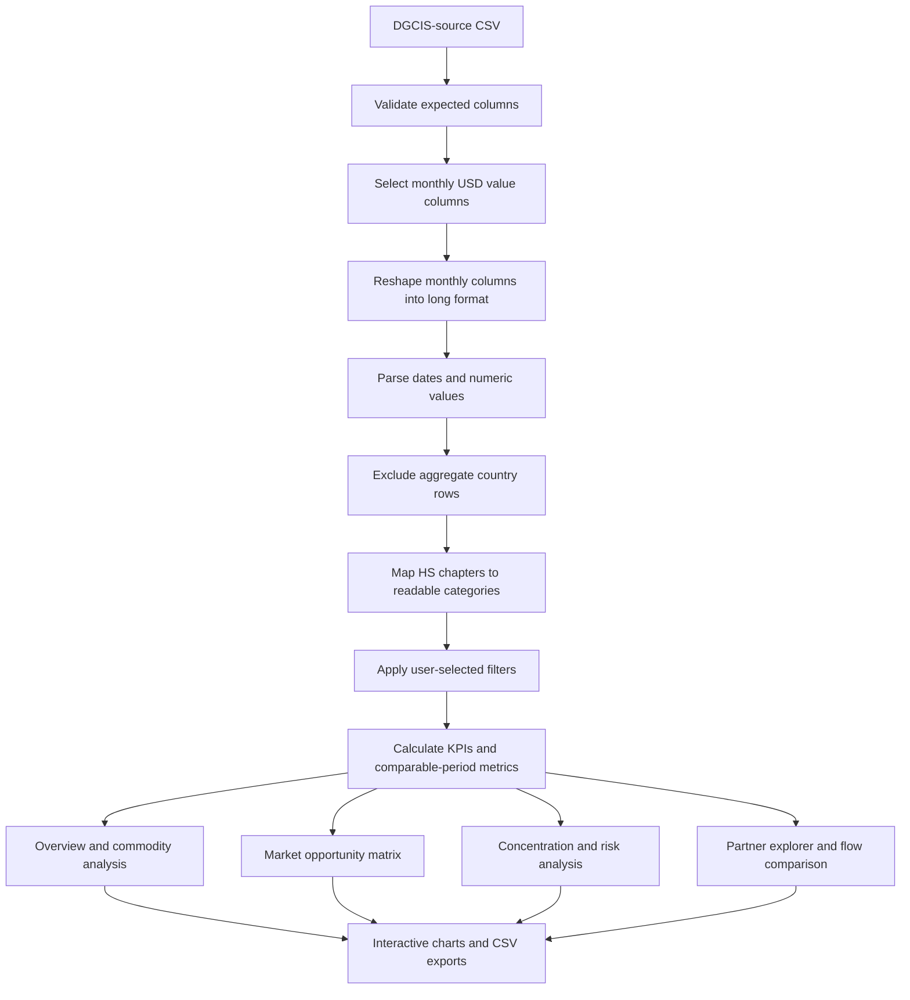

# PetroTrade Intelligence

**Market Intelligence Dashboard for Petrochemical Trade Analytics**

PetroTrade Intelligence is an interactive data analytics application for exploring India-related trade records across selected petroleum, chemical, plastics, and rubber commodity chapters. It converts monthly DGCIS-source CSV data into a set of interactive views for comparing commodity groups, examining trading-partner markets, identifying year-on-year movements, and screening market concentration.

The application is built with Python, Streamlit, Pandas, NumPy, and Plotly. It is designed as a practical market-exploration tool: users select the reporting period and market scope, and the metrics and visualisations recalculate from those records.

> **Data interpretation note:** the primary CSV does not, by itself, establish whether its values represent imports or exports. PetroTrade keeps the direction as **Direction not verified** until the user confirms the source query or supplies direction-labelled files.

---

## Contents

- [Problem Statement](#problem-statement)
- [Objectives](#objectives)
- [Main Features](#main-features)
- [Technology Stack](#technology-stack)
- [Dataset and Commodity Scope](#dataset-and-commodity-scope)
- [How the Application Works](#how-the-application-works)
- [Setup and Installation](#setup-and-installation)
- [Using the Dashboard](#using-the-dashboard)
- [Key Metrics and Calculations](#key-metrics-and-calculations)
- [Project Structure](#project-structure)
- [Limitations](#limitations)
- [Future Improvements](#future-improvements)
- [References](#references)

## Problem Statement

Trade data is often distributed across large CSV or spreadsheet exports with separate columns for each reporting month. Manually comparing commodity groups and partner markets takes time and makes it harder to spot changes, identify the largest contributors, or assess how concentrated recorded values are across markets.

PetroTrade Intelligence addresses this by providing a single interactive workspace for filtering, comparing, and interpreting the selected trade records without manually rebuilding charts for each question.

## Objectives

- Transform month-based CSV columns into a structure suitable for time-series and country-level analysis.
- Let users filter records by year, months, commodity family, HS chapter, and trading partner.
- Compare current-period values with the same months in the previous year where a valid prior-period baseline exists.
- Summarise commodity composition and partner-market rankings.
- Screen commodity groups and partner markets by recorded value and comparable-period growth.
- Measure how recorded value is distributed across named partner markets.
- Support import/export comparisons only when the trade direction of each source has been verified.
- Allow users to inspect and export filtered records for further analysis.

## Main Features

### 1. Welcome / Preview Page

Introduces the application, explains the available analytical views, and displays a small snapshot of the loaded dataset before users enter the workspace.

### 2. Live Analysis Controls

The global controls allow users to select:

- Reporting year
- Months included in the analysis
- Commodity families
- Individual HS commodity chapters
- Partner market, or all named markets
- Trend chart style (line, area, or grouped bars)
- Number of markets shown in rankings

Selections are applied across the analytical pages. For concentration analysis, all named markets are considered even when a single partner is selected globally; otherwise concentration could be incorrectly calculated from a one-market-only slice.

### 3. Overview

Presents headline indicators and descriptive observations, including:

- Recorded trade value for the selected period
- Year-on-year change against comparable months
- Leading commodity share
- Number of positive-value named partner markets
- Monthly trend and historical context
- Commodity composition and top partner-market comparisons
- A **Scenario Lab** for testing a user-specified percentage change to one commodity's recorded value

The Scenario Lab is a sensitivity calculation, not a forecast.

### 4. Commodity Breakdown

Compares the selected HS chapters by recorded value, contribution, and time pattern. It includes comparative visualisations such as category charts and monthly views to make differences between groups easier to inspect.

### 5. Market Opportunity Matrix

An interactive scatter/bubble chart screens commodity groups or partner markets using:

- **Horizontal axis:** current-period recorded value
- **Vertical axis:** year-on-year change against the same months in the prior year
- **Bubble size:** current-period recorded value
- **Horizontal divider:** user-selected growth threshold
- **Vertical divider:** median current value in the selected set

The four quadrants provide relative screening labels, such as higher-value markets above the selected growth threshold. They are not investment recommendations, causal explanations, or forecasts. Entities without a positive comparable prior-year value are not assigned an ordinary percentage growth rate.

### 6. Concentration & Risk Analysis

Evaluates the distribution of positive recorded values across named partner markets for each selected commodity. The page includes:

- Top-1, top-3, and top-5 named-market shares
- Herfindahl–Hirschman Index (HHI)
- Editable top-5 share and HHI screening thresholds
- Comparison with the same months in the previous year
- Partner contribution / dependency-map visualisation
- A risk register with downloadable CSV output

Thresholds are user-defined screening settings, not official risk classifications. When direction is unverified, the page describes **recorded-value concentration** only; it does not claim supplier dependency or destination-market risk.

### 7. Imports vs Exports

Compares import and export values, growth, and trade balance when both direction-verified datasets are available and have comparable reporting periods. Trade balance is calculated as exports minus imports. If one flow is missing or unverified, the application does not silently treat it as zero.

### 8. Partner Markets

Ranks named markets, compares recorded values, and allows users to explore country-level monthly patterns and commodity composition.

### 9. Data & Methodology

Provides a searchable table of filtered records, explanations of calculations and limitations, commodity taxonomy, and a CSV download of the current filtered view.

## Technology Stack

| Technology | Role in the project |
|---|---|
| **Python** | Main programming language and application logic |
| **Streamlit** | Web application layout, navigation, forms, filters, and interactive controls |
| **Pandas** | CSV loading, cleaning, reshaping, grouping, and aggregation |
| **NumPy** | Numerical calculations and handling unavailable numeric results |
| **Plotly Express / Graph Objects** | Interactive charts, hover details, zoom, pan, and chart transitions |
| **HTML and CSS** | Custom layout, typography, cards, colour palette, and UI styling |
| **DGCIS-source CSV data** | Monthly trade records used for analysis |

There is no separate API backend or database in the current version. The application loads and processes the CSV data within the Streamlit app.

## Dataset and Commodity Scope

The current source extract supplied with the project contains **1,073 rows and 138 columns**, including metadata, monthly INR fields, monthly USD fields, and an aggregate row. The monthly USD value columns span **January 2021 to July 2026** in the current extract. These counts and dates describe the current file and may change if a refreshed extract is used.

The dashboard analyses the following five HS chapters:

| HS chapter | Display name in PetroTrade | Analytical category |
|---:|---|---|
| 27 | Mineral fuels & oils | Petroleum & energy feedstocks |
| 28 | Inorganic chemicals | Basic chemicals |
| 29 | Organic chemicals | Chemical intermediates |
| 39 | Plastics & articles | Polymers & plastics |
| 40 | Rubber & articles | Rubber & elastomers |

These are broad HS chapter groupings. They include products beyond a narrow definition of petrochemicals and should not be interpreted as a product-level classification of every petrochemical item. The human-readable analytical categories are application mappings, not separate official source fields.

### Expected CSV Structure

The app expects these columns:

- `HS Code`
- `HS Description`
- `Country Name`
- Monthly value columns named in the pattern `Month-Year_USD_Mn`, for example `January-2021_USD_Mn`

The source may contain additional columns such as `Sr. No.` and monthly INR values; the current parser uses the monthly USD-million fields. Aggregate rows such as `TOTAL`, `ALL COUNTRIES`, and `WORLD TOTAL` are excluded from named-market calculations to avoid double counting country rows and totals.

### Data Flow Setup

1. Place `DGCIS_DATA.csv` in the same folder as `app.py`.
2. Open the **Data connections** expander in the app.
3. Choose `Imports` or `Exports` for the primary file only after verifying the query settings used to download it. If the direction cannot be verified, leave it as `Direction not verified`.
4. To compare both flows, provide separate import and export CSVs with compatible HS chapters and reporting months.

## How the Application Works



### Comparable-Period Rule

For a selected year and month set, year-on-year calculations use the same selected months in the previous year. For example, if January to July is selected for 2026, the comparison uses January to July 2025, not the full year of 2025. If a prior-period denominator is zero or missing, the percentage change is left unavailable.

## Setup and Installation

### Requirements

- Python 3.10 or later recommended
- Internet connection for installing packages; the dashboard itself reads the local CSV
- The project source file `app.py`
- The source extract `DGCIS_DATA.csv`, unless using the in-app upload control

### Windows (PowerShell)

Open a terminal in the project folder and run:

```powershell
py -m venv .venv
.\.venv\Scripts\Activate.ps1
py -m pip install --upgrade pip
py -m pip install streamlit pandas numpy plotly
```

Start the application:

```powershell
py -m streamlit run app.py
```

Streamlit normally opens a browser tab automatically. If not, visit:

```text
http://localhost:8501
```

To stop the app, press `Ctrl + C` in the terminal.

### macOS / Linux

```bash
python3 -m venv .venv
source .venv/bin/activate
python -m pip install --upgrade pip
python -m pip install streamlit pandas numpy plotly
python -m streamlit run app.py
```

## Using the Dashboard

1. Start on the Welcome / Preview page to read the project scope.
2. Use the live controls to select the reporting year, months, commodity family, HS chapters, and partner market.
3. Review the Overview KPIs and executive readout.
4. Open **Commodity breakdown** to compare selected groups.
5. Open **Market opportunity matrix** to screen by recorded value and comparable-period growth.
6. Open **Concentration & risk** to review top-market shares, HHI, and the risk register.
7. Open **Imports vs exports** after both flows have been verified and loaded.
8. Use **Partner markets** for country-level analysis.
9. Use **Data & methodology** to search the records, review calculation notes, and download the filtered CSV.

## Key Metrics and Calculations

### Year-on-Year Change

\[
\text{YoY Change (\%)} = \frac{V_t - V_{t-1}}{V_{t-1}} \times 100
\]

`V_t` is the selected-period value and `V_(t-1)` is the value for the comparable months in the previous year. This calculation is only meaningful when the previous-period value is positive and available.

### Commodity Share

\[
\text{Commodity Share (\%)} = \frac{\text{Commodity Value}}{\text{Selected Total Value}} \times 100
\]

The denominator is the selected dataset scope, not necessarily the total value of all Indian international trade.

### Top-k Partner Share

\[
\text{Top-k Share (\%)} = \sum_{i=1}^{k} s_i
\]

where `s_i` is each partner's percentage share of positive recorded values. PetroTrade calculates Top-1, Top-3, and Top-5 shares for concentration analysis.

### Herfindahl–Hirschman Index (HHI)

\[
\text{HHI} = \sum_{i=1}^{n} s_i^2
\]

Here `s_i` is the partner's percentage share, expressed in percentage points, so the index ranges from near 0 to 10,000. HHI is descriptive of the distribution within the selected dataset; the dashboard's configurable thresholds are analyst-defined flags, not regulatory determinations.

### Trade Balance

\[
\text{Trade Balance} = \text{Exports} - \text{Imports}
\]

PetroTrade only calculates this value when both import and export data are available and direction-verified for a comparable scope.

## Project Structure

A simple local setup can use the following structure:

```text
PetroTrade-Intelligence/
├── app.py
├── DGCIS_DATA.csv
├── README.md
└── .streamlit/
    └── config.toml       # Optional Streamlit UI configuration
```

If you create a `requirements.txt`, it can contain:

```text
streamlit
pandas
numpy
plotly
```

## Limitations

- The default source extract does not identify import/export direction in its columns. Direction must be verified from the DGCIS query settings before flow-specific conclusions are made.
- The current scope uses five broad HS2 chapters; it is not a comprehensive product-level petrochemical dataset.
- Year-on-year comparisons depend on available months and on a positive previous-period baseline.
- The Market Opportunity Matrix is a screening view based on recorded value and historical growth, not a forecast or investment recommendation.
- Concentration analysis measures recorded-value distribution across named partner markets. Supplier dependency is only a defensible interpretation when an import flow has been verified; destination-market exposure requires a verified export flow.
- The application performs descriptive analysis and what-if arithmetic. It does not currently implement a trained forecasting model or machine-learning risk model.
- Results depend on data completeness, consistency, the selected scope, and the reporting methodology of the source extract.

## Future Improvements

- Extend the source to more detailed HS6/HS8 product codes where available.
- Add a downloadable analyst brief with selected KPIs, charts, and observations.
- Add automated data-quality tests for duplicates, missing months, and unusual values.
- Add import/export comparison using verified, compatible datasets.
- Consider validated forecasting or anomaly detection only after suitable historical data and evaluation procedures are available.

## References

1. **Department of Commerce, Government of India.** Trade Intelligence and Analytics (TIA) Portal / DGCIS-source trade data: [https://www.trade-analytics.commerce.gov.in/public](https://www.trade-analytics.commerce.gov.in/public)
2. **Streamlit documentation.** Installation and application development: [https://docs.streamlit.io/](https://docs.streamlit.io/)
3. **Pandas documentation.** Data analysis and reshaping: [https://pandas.pydata.org/docs/](https://pandas.pydata.org/docs/)
4. **NumPy documentation.** Numerical computing: [https://numpy.org/doc/](https://numpy.org/doc/)
5. **Plotly Python documentation.** Interactive visualisation: [https://plotly.com/python/](https://plotly.com/python/)

---

## Repository

After creating the GitHub repository, add its URL here or in your project documentation. Do not publish the source data unless its terms of use allow redistribution.

## Acknowledgement

This project was developed as a data analytics application using a DGCIS-source trade extract. The labels and analytical categories used in the dashboard are intended to support exploration and should not be mistaken for official trade classifications beyond the underlying HS codes and source fields.
